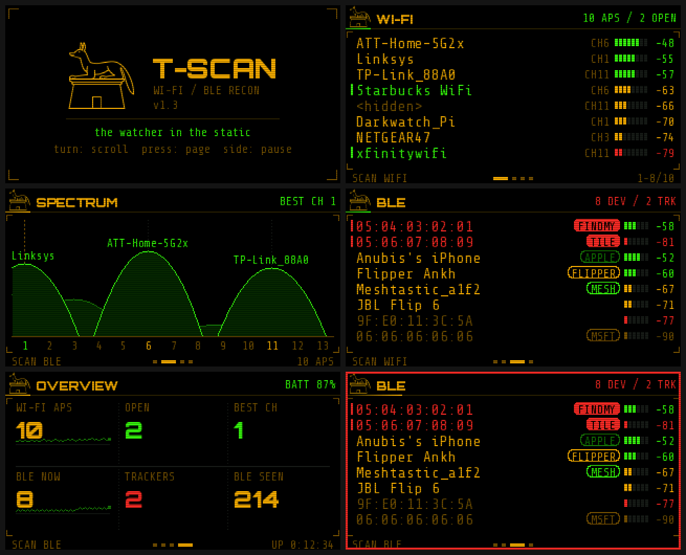
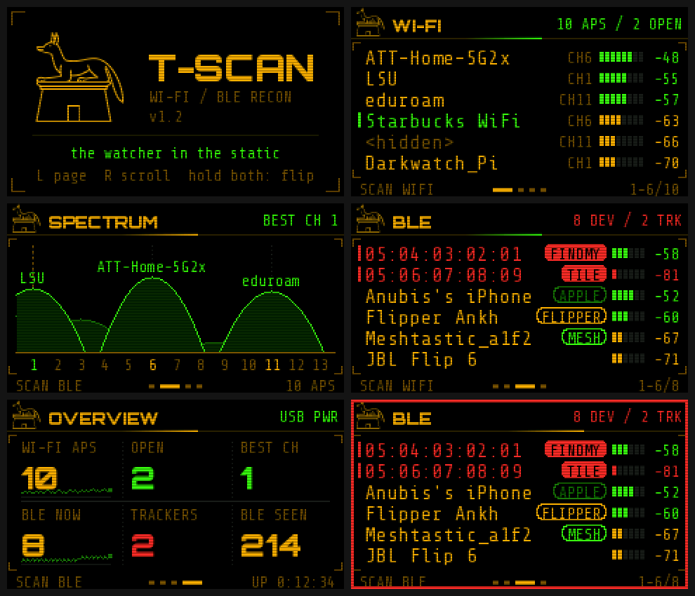
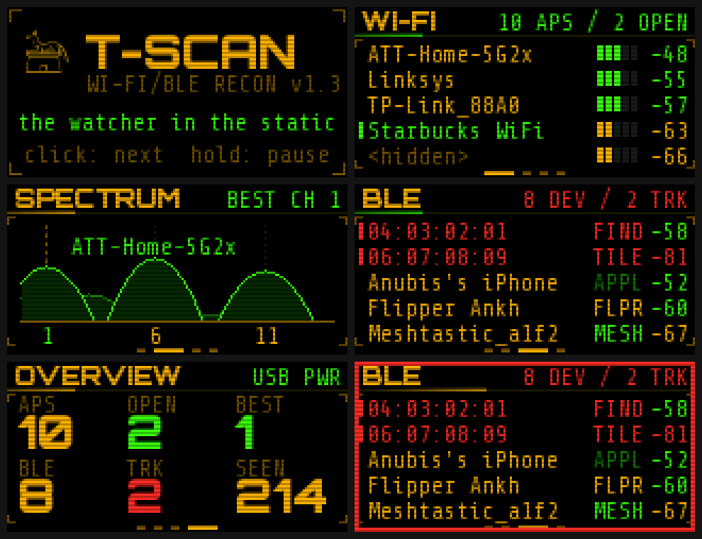

# T-Scan v1.3 — Wi-Fi / BLE scanner for LilyGo boards (Anubis Darkwatch edition)

Pocket recon screen for LilyGo boards with displays. Nearby Wi-Fi, a channel
spectrum, BLE devices with tracker flags, and an overview dashboard. Listens
and logs only — it never connects to anything.

| Board | Screen | Firmware |
|---|---|---|
| LilyGo TTGO **T-Display** (ESP32) | 1.14" 240×135 | [`firmware/T-Scan-v1.3-tdisplay.bin`](firmware/T-Scan-v1.3-tdisplay.bin) |
| LilyGo **T-Embed CC1101** (ESP32-S3) | 1.9" 320×170 | [`firmware/T-Scan-v1.3-tembed-cc1101.bin`](firmware/T-Scan-v1.3-tembed-cc1101.bin) |
| LilyGo **T-Dongle S3** / S3 Plus (ESP32-S3) | 0.96" 160×80 | [`firmware/T-Scan-v1.3-tdongle-s3.bin`](firmware/T-Scan-v1.3-tdongle-s3.bin) |

T-Display screens

T-Dongle S3 screens (compact layout)

Brand look: black, amber `#ffb000` + neon green `#39ff14`, Orbitron Black +
Share Tech Mono, jackal mark, HUD brackets, CRT scanlines, CRT power-on boot.

## Flash it (browser, no installs)
1. Plug the board into USB-C. Chrome or Edge on desktop.
2. Open https://espressif.github.io/esptool-js/ → **Connect** → pick the board's COM port.
3. Download the `.bin` for your board from the table above, flash address **0x0** → **Program**.
4. When it finishes, unplug and replug USB.

If Connect fails, put the board in download mode and try again:
- **T-Display:** hold the left front button, tap the small reset button on the top edge, release.
- **T-Embed CC1101:** hold the knob pressed down while plugging in USB (or while tapping reset), release.
- **T-Dongle S3:** hold the BOOT button while plugging it in, release.

## Controls
**T-Display**
| Button | Short | Hold (~1 s) |
|---|---|---|
| Left | Next page (slides in) | Screen off / on |
| Right | Scroll 6 rows | Pause / resume scanning |
| **Both** | — | **Rotate 180°** (remembered) |

Left/right follow the screen, so after flipping, the left button is still the one on your left.

**T-Embed CC1101**
| Control | Action |
|---|---|
| Turn knob | Scroll one row |
| Press knob | Next page · hold: screen off / on |
| Side key | Pause / resume scanning · hold: **rotate 180°** (remembered) |

**T-Dongle S3** (one button)
| Press | Action |
|---|---|
| Click | Next: pages through a long list, then moves to the next screen |
| Hold ~1 s, release | Pause / resume scanning (LED turns amber while held) |
| Hold ~3 s, release | **Rotate 180°**, remembered (LED turns magenta while held) |

The dongle's RGB LED pulses amber during Wi-Fi scans and green during BLE,
glows dim red when paused, and flashes red for a new tracker. Its tiny screen
uses a compact layout: no header jackal, five rows per list, short tags
(`FIND`, `TILE`, `STAG`, `FLPR`, `MESH`…), channel labels 1 / 6 / 11 only.

On the T-Embed, the LED ring mirrors the scanner: amber comet = Wi-Fi scan, green = BLE scan,
one dim red = paused, all red flashing = new tracker. Battery % comes from the
board's fuel gauge.

## Screens
- **Header** — jackal, page title, live counts. The sweep along the header rule
  shows what's scanning: green = Wi-Fi, amber = BLE; solid red = paused.
- **Wi-Fi** — strongest first: SSID, channel, signal meter, dBm.
  Green name + green side mark = open network. Dim `<hidden>` = hidden SSID.
- **Spectrum** — every AP drawn as a curve across the channels it actually
  occupies (±2), height = signal. Strongest three are labelled. Dashed amber
  line + `BEST CH` = least crowded of 1 / 6 / 11.
- **BLE** — trackers first, then by signal. Pills: `FINDMY` / `TILE` /
  `SMARTTAG` (solid red = tracker), `FLIPPER`, `MESH` (Meshtastic), `APPLE`,
  `IBEACON`, `MSFT`. Dim = not heard for 15 s; gone after 60 s.
- **Overview** — APs, open, best channel, BLE now, trackers, total BLE seen,
  with sparklines of the last ~40 scan cycles. Battery up top.
- **Tracker alert** — the frame flashes red when a new tracker shows up.

Signal colours: green ≥ −60 dBm, amber ≥ −75, red weaker.

Phones and tags rotate random MACs every ~15 min, so "BLE seen" overcounts on
long sessions. One FindMy tag near you for hours that isn't yours is worth a
look; a few at a venue is normal.

## Serial log
115200 baud, CSV: `W,ms,bssid,ssid,ch,rssi,auth` per AP per scan,
`B,ms,mac,addr_type,name,rssi,tag` per new BLE address. Boot stages print as `# boot: …`.

## Build from source
- PlatformIO: `pio run -e tdisplay`, `-e tembed-cc1101` or `-e tdongle-s3`.
- Layout: `src/ui.h` draws everything and sizes itself from `SCR_W`/`SCR_H`;
  screens under 100 px tall get the compact layout.
  `src/board.h` holds each board's power-up, inputs, battery and LEDs.
  `src/main.cpp` is scanning and app logic. Display pins live in `platformio.ini`.
- Adding a board: a new `[env]` with its display flags + `SCR_W/SCR_H`, and a
  `#elif defined(BOARD_…)` block in `board.h`.
- Fonts: `python3 tools/mkfonts.py <fonts dir> src/brand_fonts.h` (fontsource
  packages from npm: `@fontsource/orbitron`, `@fontsource/share-tech-mono`,
  `@fontsource/noto-sans-egyptian-hieroglyphs`; all OFL).
- PC previews of every screen: `g++ -std=c++17 -Itools/preview/stub -include cstring
  [-DSCR_W=320 -DSCR_H=170] tools/preview/host.cpp -o host && ./host outdir` (writes PPMs).

## License
Code: MIT (see `LICENSE`). Fonts: SIL OFL 1.1 (see `FONTS-LICENSE.md`).
